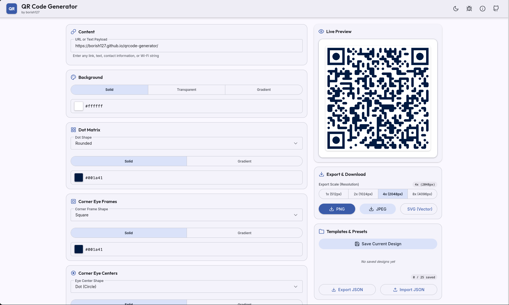

# QR Code Generator

A static, client-side web application for generating beautiful, customized, and high-resolution QR codes directly in your browser. This tool provides advanced styling options including multi-stop gradients, customized dot geometries, corner eye styling, and center logo embedding, all rendered 100% locally with zero backend dependencies.

## Usage

QR Code Generator runs entirely in your browser with zero installation, tracking, or account setup required. You can access and use the live application directly here:

[**https://borish127.github.io/qrcode-generator/**](https://borish127.github.io/qrcode-generator/)

## Features

* **Content Agnostic:** Create QR codes for any URL, plain text, Wi-Fi configuration, email, vCard contact, or cryptocurrency address.
* **Custom Matrix Geometries:** Choose from 6 distinct module shapes: *Rounded*, *Dots (Circular)*, *Classy*, *Classy Rounded*, *Square (Classic)*, and *Extra Rounded*.
* **Advanced Color Engine:**
  * Solid colors or custom 2-stop linear gradients.
  * Independent color and gradient angle controls for the background, data dots, corner eye frames, and corner eye centers.
  * Full transparent background support for seamless graphic design and printing overlays.
* **Center Logo Integration:**
  * Drag-and-drop or click to upload PNG, JPEG, SVG, or WebP logos.
  * Configurable logo scaling (10% to 50%) and margin padding.
  * Toggle dot clearing behind the logo to prevent visual interference.
  * High error correction (Level H — up to 30% restoration capacity) to preserve scan reliability.
* **Multi-Format High-Res Export:**
  * **SVG:** Infinitely scalable vector graphics for Figma, Illustrator, and laser cutting.
  * **PNG & JPEG:** High-DPI raster exports from 1x (512px) up to 8x (4096px Ultra-HD).
* **Local Presets & Session Gallery:**
  * Save favorite designs to your browser's local gallery with live visual thumbnails.
  * Export and import configuration profiles as `.json` files to back up or share your designs.
* **Responsive Material Design 3:** Built with Material Design 3 Expressive tokens, dark/light theme switching, and seamless desktop and mobile layouts.
* **100% Private:** No user data or scanned URLs are transmitted to any remote server. Everything executes client-side in browser memory.

## Technology Stack

* **Core Interface:** HTML5, CSS3, Vanilla JavaScript (ES6+).
* **Design System:** Material Design 3 (MD3) Expressive Design Tokens with Google Fonts (*Outfit* and *Inter*).
* **QR Engine:** [`qr-code-styling`](https://github.com/kozakdenys/qr-code-styling) (Canvas & SVG vector pipeline).
* **Deployment:** GitHub Pages via GitHub Actions.

## Contributing

We welcome contributions to QR Code Generator! Whether you would like to report a bug, suggest new dot shapes or export presets, optimize mobile styling, or propose new features, your help is appreciated.

How to contribute:

1. Fork the project.
2. Create your feature branch (`git checkout -b feature/NewFeature`).
3. Commit your changes (`git commit -m 'Add some NewFeature'`).
4. Push to the branch (`git push origin feature/NewFeature`).
5. Open a Pull Request.

For major changes or feature proposals, please open an issue first to discuss what you would like to change.

## License

This project is licensed under the GNU General Public License v3.0 &mdash; View [LICENSE.md](LICENSE.md) for details.

## Credits

* **Core Engine:** Built using the open-source [`qr-code-styling`](https://github.com/kozakdenys/qr-code-styling) library by Denys Kozak.
* **Design System:** Inspired by Material Design 3 Expressive guidelines and the clean layout architecture of [PyFDA-Web](https://github.com/borish127/PyFDA-Web).
